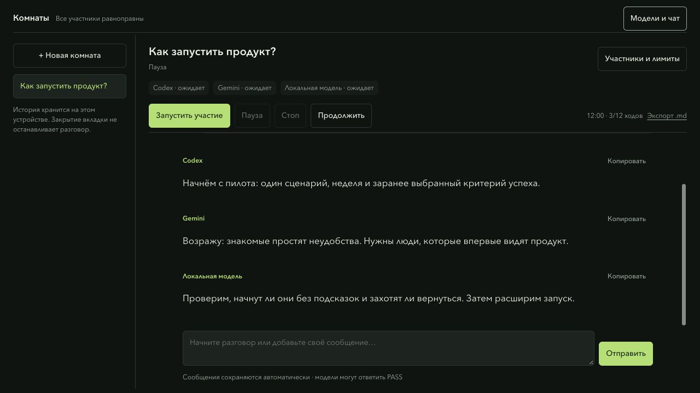
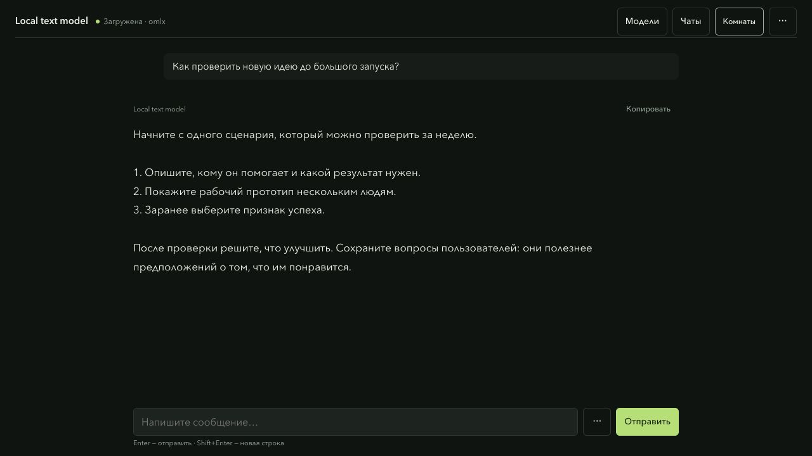
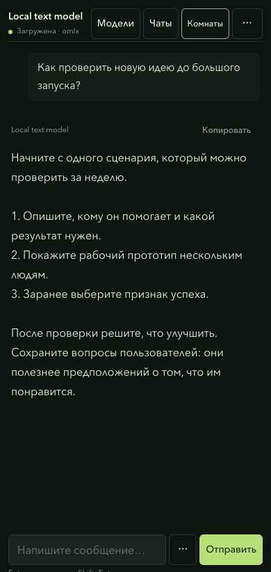
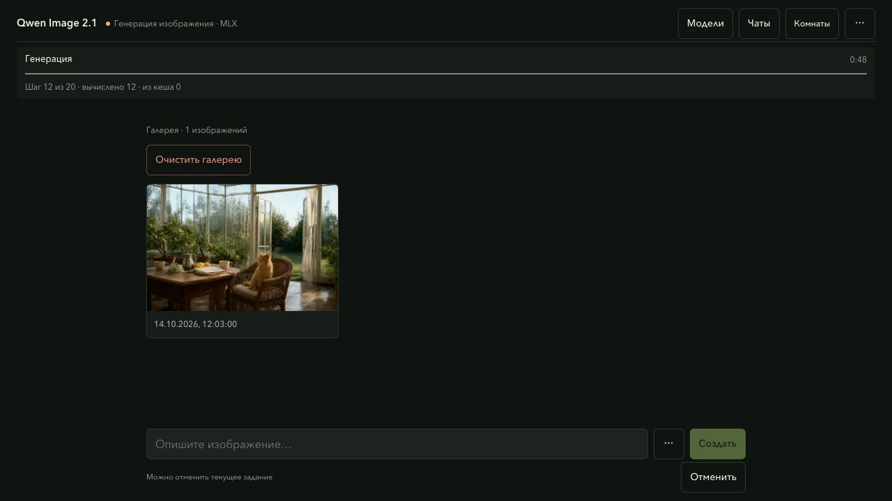
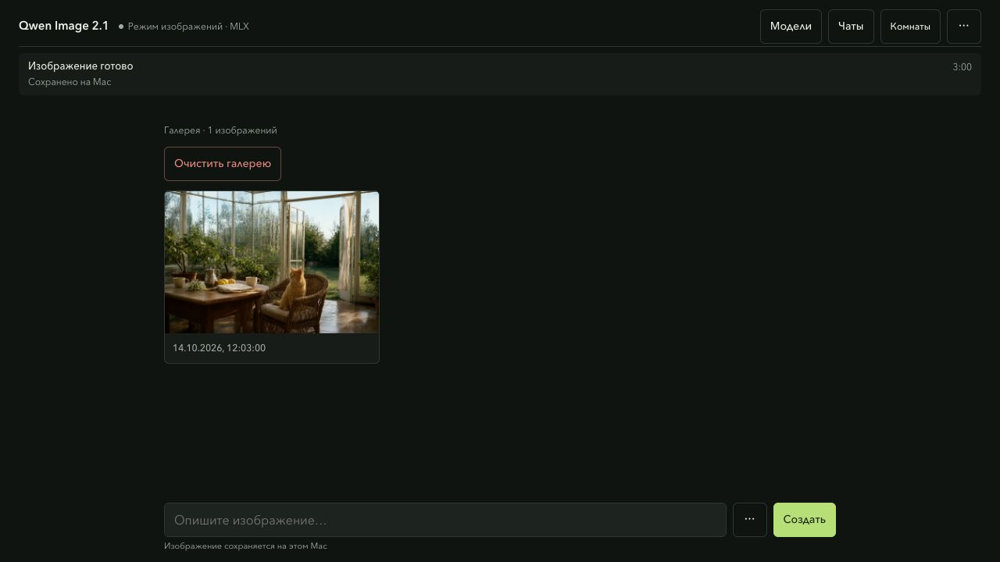
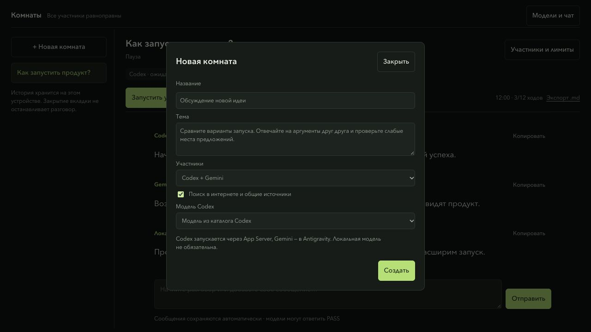
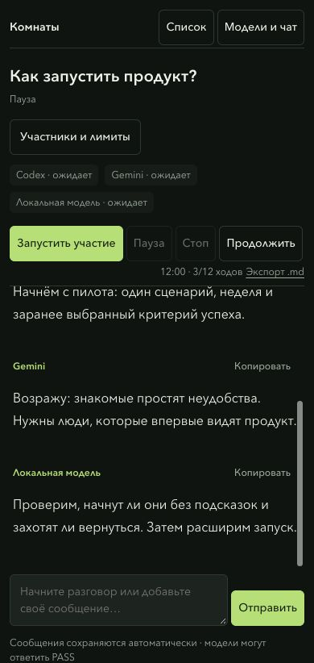
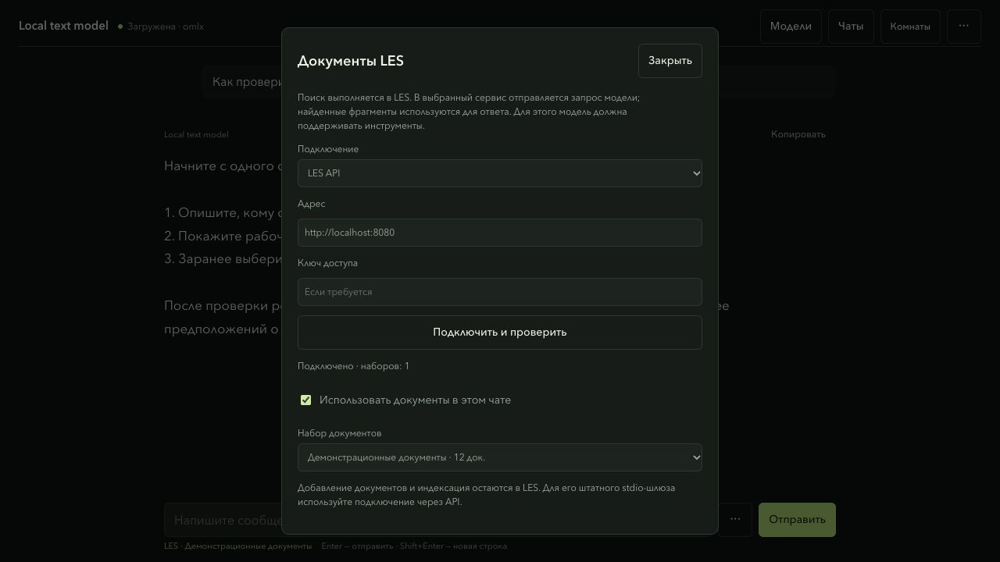

<div align="center">

# УЗЕЛ

### Локальное управление моделями на Apple Silicon

Локальные модели, изображения и общие разговоры с ИИ в одном рабочем пространстве.
Соберите Codex, Gemini и локальную модель в комнате: задайте вопрос,
следите за обсуждением и вмешивайтесь в любой момент.


[Запуск](#быстрый-запуск) · [Комнаты](#комнаты) · [Скриншоты](#скриншоты) · [English](README.md)

</div>



## Что внутри

| Компонент | Возможности |
| --- | --- |
| **[Менеджер](manager/README.ru.md)** | Поиск локальных моделей и движков oMLX / MLX LM, запуск, потоковый чат, сохранение разговоров и черновиков, улучшение промптов, серии и прогресс генерации, поиск по документам через LES. |
| **[Image Kit](image-kit/README.ru.md)** | Qwen Image 2.1, нативная загрузка 4-битных весов в MLX, интерактивная, прямая и пакетная генерация, дополнительный кеш денойзинга. |
| **[Комнаты](docs/rooms.md)** | Совместные разговоры Codex, Gemini, локальных моделей и MCP-участников: выбор модели, запуск клиентов, веб-источники, пауза и экспорт Markdown. |
| **[Общий запуск](run.py)** | Команды `manager`, `image` и `check` из корня пакета. |

У компонентов отдельные код и тесты. Генерация сохраняет нативную Q4-загрузку
и параметры сэмплинга Image Kit; менеджер добавляет точное переиспользование
состояния промпта и серии с моделями в памяти. Веса моделей и текстовые движки
устанавливаются отдельно.

## Быстрый запуск

Нужны **Mac с Apple Silicon** и **Python 3.12+**.

**Для чата с локальной моделью дополнительно нужен установленный движок
[MLX LM](https://github.com/ml-explore/mlx-lm) или
[oMLX](https://github.com/jundot/omlx), а также скачанная текстовая модель.**
Установка пакета ниже добавляет менеджер и Image Kit; текстовый движок и веса
в неё не входят. Комнате только с десктопными участниками нужны выполненный вход
в Codex и Gemini; локальная текстовая модель необязательна.

```sh
git clone https://github.com/proovcme/uzel.git
cd uzel
python3.12 -m venv .venv
.venv/bin/python -m pip install ./image-kit
.venv/bin/python run.py
```

Откройте **http://127.0.0.1:1924/**. Выберите модель, нажмите «Запустить»
и введите промпт. При выборе модели интерфейс переключается между чатом
и параметрами изображения.
Для совместного разговора откройте **«Комнаты»**. Если нужны только чат и комнаты,
шаг `pip install ./image-kit` можно пропустить.

Менеджер обнаруживает установленные движки и каталоги моделей по настройкам
runtime, переменным окружения и стандартным кешам.
[Автопоиск и дополнительные папки](docs/model-discovery.md).

Для изображений нужен полный snapshot `mlx-community/Qwen-Image-2.1-MLX-4bit`.
`run.py image` открывает Image Kit и позволяет скачать недостающие веса.
Менеджер ничего не скачивает и не загружает без явного запуска.
[Установка и условия использования весов](image-kit/README.ru.md).

Для **поиска в интернете с источниками** установите `.venv/bin/python -m pip install -r manager/requirements-web.txt` и включите поиск в **меню ⋯ у поля ввода**. [Настройка и ограничения](docs/web-search.md).

## Скриншоты

### Больше места для ответа

В компактной шапке видны выбранная модель и её состояние. Кнопка **«Чаты»**
открывает сохранённые разговоры; управление моделями и диагностика не занимают
место у ответа. Поиск, документы и параметры открываются из меню у поля ввода.



<details>
<summary>Mobile / Мобильный чат</summary>



</details>

Ответ идёт потоком. Видны обработка промпта, рассуждение и ответ.
Разговоры, полученная часть прерванного ответа, системные промпты,
параметры и черновики сохраняются на диске. «Новый чат» оставляет
предыдущие разговоры в истории.

### Генерация видна по шагам



Видны стадии, шаги и время генерации. Готовые работы можно скачать как PNG,
повторить с сохранёнными параметрами или переместить в локальную корзину.
[Промпты, ограничения и серии](image-kit/docs/manager-workflow.ru.md).

<details>
<summary>Галерея</summary>



</details>

Все скриншоты интерфейса сделаны на отдельном демосервисе с искусственными
комнатами, сообщениями, документами и состоянием прогресса. Изображения — публичные примеры
Image Kit. Это демонстрация интерфейса, а не замеры скорости или подтверждение
работы установленного LES. Личной истории, имён локальных моделей, ключей и путей
компьютера в них нет.

## Комнаты

Откройте **«Комнаты»**, выберите **Codex + Gemini**, укажите модель Codex
и напишите первое сообщение. **«Запустить участие»** создаёт сеансы:
Codex подключается через App Server, Gemini — через окно Antigravity на Mac.
Обязательной локальной модели нет. Её можно добавить через работающий движок
или явно указанный локальный endpoint.

Участники отвечают по очереди. Можно вмешиваться, ставить разговор на паузу,
продолжать и ограничивать время или число ходов. Веб-поиск позволяет MCP-участникам
делиться ссылками и выдержками со всей комнатой. Переписка сохраняется локально;
доступен экспорт Markdown. Десктопные участники отправляют контекст комнаты
через сервисы своих клиентов; локальное хранение не делает их офлайн-моделями.



Codex использует существующий вход через ChatGPT и выбранную модель из живого
каталога App Server. Для Gemini нужны режим Antigravity, Apple Command Line Tools
и «Универсальный доступ» для отдельного помощника **UZEL Gemini**.
Запуск клиентов пока экспериментальный: во время подготовки не переключайте окно
Gemini. При ошибке комната ставится на паузу; иногда нужен повторный запуск.
Короткие разговоры двух клиентов и трёх участников проверены; непрерывная работа
30 минут пока не подтверждена.

[Локальный плагин](plugins/uzel-rooms/) отдельно подключает уже активный сеанс
Codex/ChatGPT Work через индивидуальный MCP-ключ. Сам MCP не будит неактивную модель.
Лимиты использования десктопных клиентов сохраняются.
[Настройка, требования и границы интеграций](docs/rooms.md).

<details>
<summary>Комнаты на телефоне</summary>



</details>

## Документы через LES



Откройте **⋯ → Документы LES**, подключите API запущенного
[LES RAG](https://github.com/proovcme/LES), выберите набор и включите его для чата.
Модель с поддержкой инструментов сама формулирует запросы и читает найденный
контекст. Ответ идёт потоком; выдержки и ссылки на оригиналы сворачиваются под
ним, с обозначениями `[D1]`. Недоступный индекс или неподходящая модель приводят
к явной ошибке.

Файлы, OCR и индексация остаются в LES. Менеджер подключается к API;
для MCP HTTP нужен совместимый шлюз. Он не запускает LES и не копирует корпус.
[Настройка, API и границы передачи данных](docs/les-rag.md).

## От идеи к серии изображений

Выберите Qwen Image и откройте **⋯ → Настройки изображения**. При желании
включите улучшение промпта установленной текстовой моделью, проверьте результат
и задайте **«В серии»** от 1 до 20. Менеджер создаст изображения последовательно
с разными seed; готовые работы останутся в галерее.

[Промпты, серии и остановка — в документации Image Kit](image-kit/docs/manager-workflow.ru.md).

## Несколько команд

```sh
.venv/bin/python run.py                 # менеджер моделей
.venv/bin/python run.py image           # интерактивная генерация
.venv/bin/python run.py image direct --help # прямая генерация
.venv/bin/python manager/cli.py status
.venv/bin/python run.py check           # проверки обоих компонентов
```

`check` запускает оба набора Python-тестов и проверки JavaScript. Нужны зависимости
Image Kit; модели не скачиваются, бенчмарк генерации не запускается.
[CI](.github/workflows/checks.yml) проверяет менеджер на Linux, Image Kit — на macOS;
проверки Metal пропускаются без GPU. [Границы проверок и восстановление](docs/reliability.md).

## Локальная работа

- Один управляемый тяжёлый процесс одновременно. Активные запросы
  и конфликт с внешним процессом блокируют переключение.
- После перезапуска сервис восстанавливает собственные процессы по PID,
  времени запуска, команде и группе процесса.
- Удаление показывает папку и требует ввода имени модели. Папка перемещается
  в корзину вместе с HF blobs, refs и snapshots; её можно вернуть обратно.
- Данные хранятся в `~/.local/share/mlx-manager`. Чаты и промпты сохраняются
  там намеренно; в Git они не входят.

Сервис слушает только loopback, аутентификации нет. Используйте его на
доверенном локальном компьютере и не открывайте порт в сеть. Прямой запуск
движков за пределами менеджера может обойти его блокировку ресурсов.
Чат пока принимает текст; прикрепление изображений для VLM ещё не реализовано.

**Генерация без кеша** — эталонный режим. `balanced` ускоряет вычисления
с возможным изменением изображения. Измерения и ограничения приведены
в [Image Kit](image-kit/README.ru.md).

## Документация

[Настройка менеджера](manager/README.ru.md) · [Генерация и batch](image-kit/README.ru.md) ·
[English](README.md) · [Лицензия MIT](LICENSE)

УЗЕЛ — новое имя MLX Manager. Существующий каталог данных и настройки
`MLX_MANAGER_*` совместимы; для новых настроек доступен префикс `UZEL_*`.
